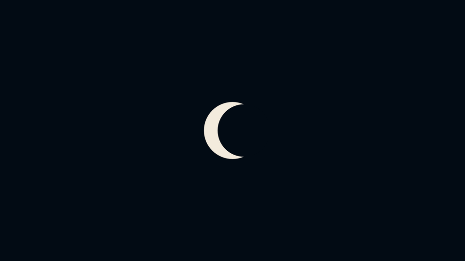

<div align="center">



**A deterministic, data-driven 2D game engine written in Go.**

Write the game once. Run it in a native window, in the browser, or headless —<br>
with bit-identical simulation, rewind, and replay on every platform.

[](https://github.com/dhannyell/arasy/releases)
[](https://github.com/dhannyell/arasy/actions/workflows/ci.yml)
[](https://pkg.go.dev/github.com/dhannyell/arasy)
[](go.mod)
[](LICENSE)

[Getting started](#getting-started) ·
[Examples](#examples) ·
[Documentation](#documentation) ·
[Architecture](#architecture) ·
[Contributing](#contributing)

</div>

---

> [!NOTE]
> Arasy follows [semantic versioning](https://semver.org). Before `v1.0.0`, a
> minor release can change the public API. Each release lists its changes in
> the [release notes](https://github.com/dhannyell/arasy/releases).

## Why Arasy

- **Deterministic by contract.** The driver owns a fixed timestep. Simulation
  results match bit for bit on x86-64, arm64, and WebAssembly, and CI checks
  the same checksum golden on all three.
- **Time is a first-class tool.** Rewind, scrub back and forth, fork a
  timeline, and replay a recorded session. A per-tick checksum proves that
  every replay is exact.
- **One game, three hosts.** A game implements one small interface. A native
  desktop host, a browser host, and an offline raster host all drive it
  through the same `runtime.Driver`.
- **Data-driven.** Textures, sprite sheets, fonts, audio, particles, splash
  screens, and tile maps come from layered manifests, not from code.
- **Small and inspectable.** Packages have one job each and a strict
  dependency direction. The engine core uses mostly the Go standard library.

## Features

| Area | What you get |
| --- | --- |
| **Simulation** | Entity/component world, fixed-tick physics (integration, bounds, spatial-grid broad phase, contact resolution), deterministic RNG through `ctx.Rand`, and reproducible transcendental math in `dmath` |
| **Time control** | Rewind history, bidirectional scrubbing, timeline forking, `.arrp` replay recordings, and simulation and content checksums |
| **Rendering** | Backend-agnostic render commands: shapes, images, sprite sheets, TTF/OTF text, layers, cameras with aspect modes, and retained sprite batches with interpolation |
| **Post-processing** | Fourteen fullscreen effects in `render.PostChain`, from bloom and color grading to shockwave, lens rain, and dissolve, all implemented in shared WGSL |
| **2.5D** | Tilted ground planes, sprite planes, height, depth ordering, and isometric projection |
| **Content** | Particles, presentation timelines and easing, animated SVG compiled to render commands, Tiled map import, and a boot splash playlist |
| **UI** | Immediate-mode widgets, themes, tabs and panels, and three coordinate spaces (reference canvas, playfield, and screen) |
| **Audio** | One-shot cues and continuous tracks that stay consistent under rewind, scrub, and replay |
| **Dev tools** | In-game dev panel with pause, single step, speed, rewind, and debug overlays for colliders, contacts, the spatial grid, velocities, entity IDs, and runtime stats |
| **Tooling** | The `arasy` CLI scaffolds, runs, builds, packages, and checks games for determinism hazards |

## Platforms

| Host | Package | Backend |
| --- | --- | --- |
| Native desktop | `platform/native` | WebGPU (wgpu-native) on Vulkan or DirectX 12, GLFW windowing |
| Browser | `platform/wasm` | WebGPU, with automatic Canvas2D fallback |
| Offline | `platform/raster` | Pure Go software rasterizer for PNG, animated GIF, and frame sequences |

Native support follows three tiers. See [Distribution](docs/en/distribution.md#platform-support)
for the details.

| Tier | Targets |
| --- | --- |
| Supported and tested | `windows/amd64` |
| Supported, tested in CI | `linux/amd64` |
| Best effort, compiled in CI | `darwin/arm64`, `linux/arm64`, `windows/arm64` |

The raster renderer is the exact reference for the 2D command vocabulary.
CI compares golden images and replay fixtures against it.

## Getting started

### Requirements

- Go 1.26 or newer.
- For the native host: a C toolchain (cgo). On Debian or Ubuntu, also install
  the GLFW, ALSA, and Vulkan development headers listed in
  [Distribution](docs/en/distribution.md#no-cross-compilation).
- For the browser host: a browser with WebGPU. Other browsers use the
  Canvas2D fallback.

Run `arasy doctor` at any time to check the environment.

### Install the CLI

```bash
go install github.com/dhannyell/arasy/cmd/arasy@latest
```

### Create a project

`arasy new` creates a game with native and browser entry points:

```bash
arasy new example.com/hello
cd hello
go mod tidy
arasy dev ./wasm
```

`arasy dev` serves the browser build at `http://127.0.0.1:8080` and rebuilds
when you reload the page. Use `arasy run ./native` to open a native window.

### Run an example

The examples live in the repository. Clone it and run them from the root:

```bash
git clone https://github.com/dhannyell/arasy.git
cd arasy
```

```bash
arasy run ./examples/breakout/native
```

```bash
arasy dev ./examples/breakout/wasm
```

Most examples also have a `raster` entry point that renders offline without a
window or a GPU:

```bash
go run ./examples/outpost/raster
```

## A minimal game

A game implements `runtime.Game`. `Setup` returns the configuration once,
`Init` fills the world, `Update` runs once per fixed tick, and `Render`
returns render commands. The driver steps the world after each `Update`.

```go
package hello

import (
	"github.com/dhannyell/arasy/math2d"
	"github.com/dhannyell/arasy/render"
	"github.com/dhannyell/arasy/runtime"
	"github.com/dhannyell/arasy/scene"
)

// Game is a ball that bounces inside a 16x9 world.
type Game struct {
	ball scene.EntityID
}

func (g *Game) Setup() runtime.Config {
	world := math2d.NewRect(math2d.Vec2{}, math2d.Vec2{X: 16, Y: 9})
	return runtime.Config{
		Camera: render.Camera{
			World:    world,
			Viewport: math2d.NewRect(math2d.Vec2{}, math2d.Vec2{X: 1280, Y: 720}),
		},
		Bounds:       world,
		Clear:        render.RGBA(0.04, 0.05, 0.08, 1),
		SimulationHz: 60,
		FPS:          60,
	}
}

func (g *Game) Init(ctx *runtime.UpdateContext) {
	g.ball = ctx.World.SpawnBundle(scene.Bundle{
		Transform:      &scene.Transform{Position: math2d.Vec2{X: 8, Y: 4.5}},
		Velocity:       &scene.Velocity{Linear: math2d.Vec2{X: 3, Y: 2}},
		CircleSprite:   &scene.CircleSprite{Radius: 0.35, BaseSprite: scene.BaseSprite{Color: render.RGBA(0.3, 0.9, 1, 1)}},
		CircleCollider: &scene.CircleCollider{Radius: 0.35},
		Body:           &scene.Body{InvMass: 1, Restitution: 1},
	})
}

func (g *Game) Update(ctx *runtime.UpdateContext, dt float64) {}

func (g *Game) Render(ctx *runtime.RenderContext) []render.Command {
	return ctx.World.RenderCommandsInto(nil, ctx.Alpha)
}
```

A host runs the game. This is the native entry point:

```go
package main

import (
	"example.com/hello"
	"github.com/dhannyell/arasy/platform/native"
	"github.com/dhannyell/arasy/runtime"
)

func main() {
	log, closeLog := native.NewLogger("hello")
	defer func() { _ = closeLog() }()

	if err := native.Run(&hello.Game{}, native.Options{
		Title:       "hello",
		Log:         log,
		DevTools:    true,
		GameFactory: func() runtime.Game { return &hello.Game{} },
	}); err != nil {
		log.Error("native host failed", "err", err)
	}
}
```

The browser entry point is the same program with `wasm.Run` and
`wasm.Options`. Read the [runtime guide](docs/en/runtime.md) for input,
global state with `runtime.StateSlot[T]`, post-step hooks, and rewind.

## Determinism

Replay, rewind, and checksums work only when every machine computes the same
bits. Code that runs in `Update` or `PostStep`, or that changes state in a
`StateSlot`, is simulation code and must follow four rules:

| Hazard | Use instead |
| --- | --- |
| `math` transcendentals such as `math.Sin` or `math.Exp` | `dmath` |
| Map iteration whose result depends on order | An ordered slice of keys |
| `math/rand`, `math/rand/v2`, or `crypto/rand` | `ctx.Rand` |
| `time.Now`, `time.Since`, or `time.Until` | The simulation tick |

`arasy build` refuses code that breaks these rules and names the fix for each
finding. `arasy doctor` reports the same findings as warnings. Render-only
code is free to use `math`; mark a render-only file with the `//arasy:render`
directive. A direct `go build` does not run these checks.

Read [Scrubbing and replay](docs/en/scrubbing.md) for the full contract.

## Examples

| Example | Shows |
| --- | --- |
| [`breakout`](examples/breakout) | Physics, contacts, UI overlay, dev panel, and golden replays |
| [`2048`](examples/2048) | Grid game logic, scrubbing, and golden replays |
| [`rhythm`](examples/rhythm) | Audio-synced input judgment and deterministic calibration |
| [`football`](examples/football) | Team movement, collisions, and a controlled player |
| [`uimanager`](examples/uimanager) | A data-heavy management UI with no physics |
| [`tabs`](examples/tabs) | The tab widget and titled panels |
| [`outpost`](examples/outpost) | Isometric 2.5D island with a retained tile map |
| [`parallax`](examples/parallax) | Camera layers, repeated backdrops, and an infinite floor |
| [`particles`](examples/particles) | The data-driven particle system |
| [`postfx`](examples/postfx) | Every post-processing effect behind a live control panel |
| [`vectoranim`](examples/vectoranim) | Compiled and hand-authored vector animation |
| [`splashscreen`](examples/splashscreen) | The boot splash playlist |
| [`assets`](examples/assets) | The texture and sprite manifest pipeline |

Each example has a `native`, `wasm`, or `raster` entry point, or a
combination of them. The [`bench`](examples/bench) directory holds stress
scenes for performance work.

## The `arasy` CLI

| Command | Purpose |
| --- | --- |
| `arasy new <module>` | Create a game project |
| `arasy dev [pkg]` | Serve a browser build that rebuilds on reload, or run a native build with `-p native` |
| `arasy run [pkg]` | Build and run a native game |
| `arasy build [pkg]` | Build a static browser directory, or a native executable with `-p native` |
| `arasy pack [pkg]` | Build a game and package it as a ZIP |
| `arasy serve [dir]` | Serve a finished browser build |
| `arasy doctor [pkg]` | Check the development environment and the determinism rules |
| `arasy watch` | Watch a recorded replay live, in the browser, or as a GIF |
| `arasy assets validate` | Validate layered asset directories |
| `arasy atlas` | Pack a frame sequence into a sprite sheet |
| `arasy svg` | Compile an animated SVG into render commands |
| `arasy tilemap import` | Compile a Tiled map into tile map data |
| `arasy stencil` | Render an art guide sheet for a camera projection |

Run `arasy <command> --help` for the flags of each command.

## Architecture

Dependencies point in one direction. Engine packages never import a host.

```text
cmd/, examples/  ->  platform/*  ->  runtime  ->  scene, render, input, ui, audio, asset  ->  math2d
```

| Package | Responsibility |
| --- | --- |
| [`math2d`](math2d) | Pure 2D math: vectors and rectangles |
| [`dmath`](dmath) | Reproducible transcendental functions for simulation code |
| [`render`](render) | Backend-agnostic render commands, cameras, colors, and post effects |
| [`scene`](scene) | The world, component stores, simulation systems, and checksums |
| [`runtime`](runtime) | The game contract, the driver, fixed ticks, input, rewind, and replay |
| [`input`](input) | Semantic input mapping and pointer state |
| [`ui`](ui) | Immediate-mode widgets drawn with render commands |
| [`audio`](audio) | Backend-agnostic cues and tracks |
| [`asset`](asset) | Layered manifests for textures, sprites, fonts, and audio |
| [`particle`](particle) | Data-driven particle effects |
| [`anim`](anim), [`ease`](ease) | Presentation timelines and easing curves |
| [`tilemap`](tilemap) | Tile layers converted into retained sprite batches |
| [`platform/native`](platform/native) | Desktop host |
| [`platform/wasm`](platform/wasm) | Browser host |
| [`platform/raster`](platform/raster) | Offline host and reference renderer |

Read [Architecture](docs/en/architecture.md) for the full layering rules and
[CONTEXT.md](CONTEXT.md) for the project vocabulary.

## Documentation

Every guide exists in English and in Brazilian Portuguese.

| Guide | English | Português |
| --- | --- | --- |
| Architecture | [en](docs/en/architecture.md) | [pt-br](docs/pt-br/architecture.md) |
| Runtime | [en](docs/en/runtime.md) | [pt-br](docs/pt-br/runtime.md) |
| Scrubbing and replay | [en](docs/en/scrubbing.md) | [pt-br](docs/pt-br/scrubbing.md) |
| Camera, world, and viewport | [en](docs/en/camera-world-viewport.md) | [pt-br](docs/pt-br/camera-world-viewport.md) |
| Render batches and interpolation | [en](docs/en/render-batches.md) | [pt-br](docs/pt-br/render-batches.md) |
| 2.5D projection | [en](docs/en/2-5d.md) | [pt-br](docs/pt-br/2-5d.md) |
| Animation | [en](docs/en/animation.md) | [pt-br](docs/pt-br/animation.md) |
| Vector graphics | [en](docs/en/vector-graphics.md) | [pt-br](docs/pt-br/vector-graphics.md) |
| UI | [en](docs/en/ui.md) | [pt-br](docs/pt-br/ui.md) |
| Audio | [en](docs/en/audio.md) | [pt-br](docs/pt-br/audio.md) |
| Boot splash | [en](docs/en/boot-splash.md) | [pt-br](docs/pt-br/boot-splash.md) |
| Math visual guide | [en](docs/en/math2d-visual-guide.md) | [pt-br](docs/pt-br/math2d-visual-guide.md) |
| Testing | [en](docs/en/testing.md) | [pt-br](docs/pt-br/testing.md) |
| Development commands | [en](docs/en/development.md) | [pt-br](docs/pt-br/development.md) |
| Distribution | [en](docs/en/distribution.md) | — |
| Benchmarks | [en](benchmarks/README.md) | — |

API reference: [pkg.go.dev/github.com/dhannyell/arasy](https://pkg.go.dev/github.com/dhannyell/arasy).

## Contributing

Bug reports, questions, and pull requests are welcome on
[GitHub](https://github.com/dhannyell/arasy/issues).

Before you open a pull request, run the same gates as CI:

```bash
gofmt -l .
go vet ./...
go test ./...
golangci-lint run ./...
```

A change to the browser host or to shared engine packages must also pass the
WebAssembly build. A pull request that changes a golden image or a replay
fixture must explain why. [Development commands](docs/en/development.md)
lists every gate, and [AGENTS.md](AGENTS.md) lists the engineering rules.

## License

Arasy is released under the [MIT License](LICENSE). Third-party assets and
fonts are listed in [CREDITS.md](CREDITS.md).
