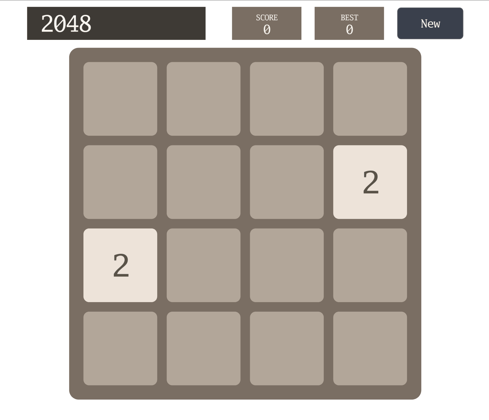

# 2048

Slide the tiles and join equal numbers until one tile reaches 2048.

[](https://dhannyell.github.io/arasy/examples/2048/)



## What it shows

- Grid game logic that runs only in the fixed tick, so a rewind or a replay restores the board exactly.
- Semantic input: arrows, WASD, and a pointer drag on the board all feed the same move actions.
- Turn animations that are stored in the game state, so they survive a rewind.
- A golden replay test that drives the real game and checks its checksums.

## Controls

- Arrow keys or WASD: slide the tiles.
- Drag on the board: slide the tiles.
- Undo: take back a move (three charges per game).
- New: start a new game.

## Run locally

From the repository root:

```bash
go run ./cmd/arasy dev ./examples/2048/wasm
```

Then open the address that the command prints.

Native window:

```bash
go run ./cmd/arasy run ./examples/2048/native
```

Offline PNG through the raster host:

```bash
go run ./examples/2048/raster
```
