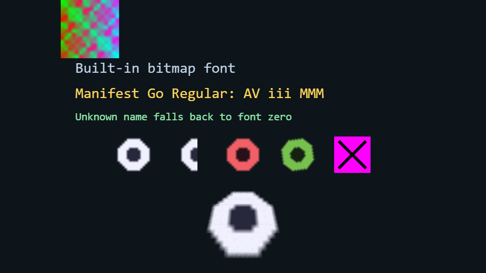

# Assets

A gallery of the data-driven texture, sprite, and font pipeline.

[](https://dhannyell.github.io/arasy/examples/assets/)



## What it shows

- Textures, sprites, and fonts declared in `assets/manifest.json` and loaded by name.
- The built-in bitmap font, a manifest font, and the fallback to font zero for an unknown name.
- The missing-texture placeholder for an entry that does not decode.
- The browser build forces Canvas2D on purpose, so the page also shows the fallback renderer.

## Run locally

From the repository root:

```bash
go run ./cmd/arasy dev ./examples/assets/wasm
```

Then open the address that the command prints.

Native window:

```bash
go run ./cmd/arasy run ./examples/assets/native
```

Offline PNG through the raster host:

```bash
go run ./examples/assets/raster
```
