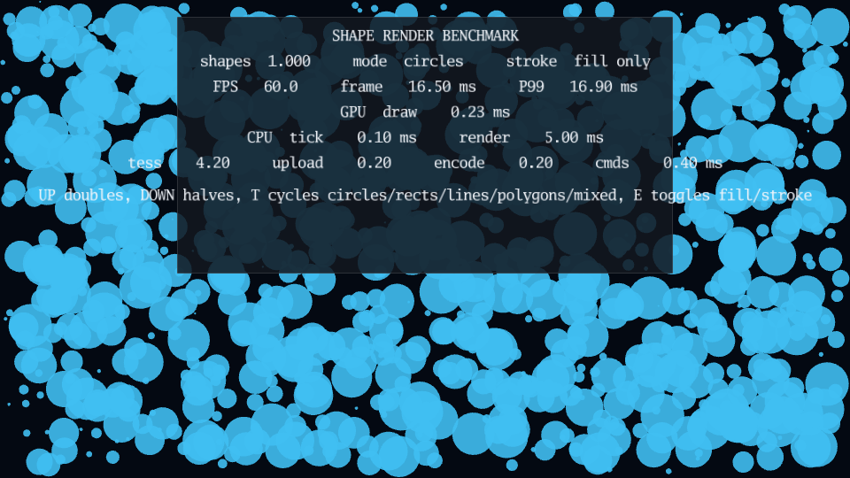

# Shape render benchmark

[](https://dhannyell.github.io/arasy/examples/bench/shapebench/)



Build and serve the standalone browser benchmark:

```bash
go run ./cmd/arasy dev ./examples/bench/shapebench/wasm -a 127.0.0.1:8094
```

It bounces its own slice of solid-geometry shapes (position, velocity,
rotation) around a 1920x1080 world and emits one draw command per shape:
`render.DrawCircle`, `render.DrawRect`, `render.DrawLine` or
`render.DrawPolygon`. This isolates the vector tessellation path:
`tess.Build` tessellating each primitive into vertex streams, then the byte
conversion and upload that follow. Circles are the reference workload for
future analytic-AA work (signed-distance-field rendering), so they get their
own dedicated mode alongside the other primitives.

Controls:

- `UP` doubles the shape count, `DOWN` halves it (starts at 1,000, clamped to
  [1, 200,000]).
- `T` cycles the shape mode: circles (radii cycling 2-50px) -> rects -> lines
  (width 2-6px) -> polygons (5-8 sides) -> mixed (all four interleaved by
  index).
- `E` toggles fill-only versus fill+stroke for circles, rects and polygons
  (lines have no separate stroke in the render API, so the toggle only
  changes those three).

The HUD reports shape count, shape mode, stroke mode, rolling FPS, frame
time, P99 frame time, the WebGPU render pass GPU time, and the same CPU
tick/render and tessellation/upload/encode breakdown reported by the sprite
and text benchmarks.
