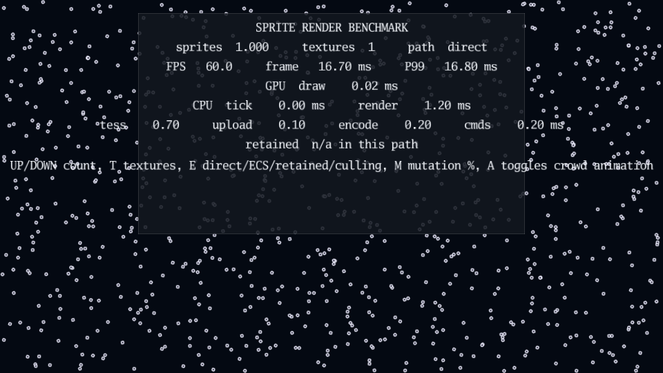

# Sprite render benchmark

[](https://dhannyell.github.io/arasy/examples/bench/spritebench/)



Build and serve the standalone browser benchmark:

```bash
go run ./cmd/arasy dev ./examples/bench/spritebench/wasm -a 127.0.0.1:8092
```

It bounces its own slice of sprites (position, velocity, rotation) around a
1920x1080 world and cycles through four render paths at the same sprite
count:

- **direct** (default): one `render.DrawImage` per sprite built straight
  from the slice, bypassing the ECS so results isolate the tess/upload path:
  `tess.Build` packing draw commands into 64-byte storage records, the
  JS-heap upload that follows, and the instanced WebGPU draw which expands
  each record into a quad.
- **ECS**: the same sprites mirrored into `scene.World` entities
  (`Transform` + `ImageSprite`, no colliders) and rendered through
  `World.RenderCommands`, so each frame additionally pays the per-tick
  `SetTransform` store writes, the `SyncRenderState` transform clone and the
  `RenderCommands` id-sort/command building. The delta between direct and
  ECS at the same sprite count is the ECS render-path overhead, including how
  the extra allocation churn interacts with the single-threaded wasm GC
  (watch P99).
- **retained**: sprites are published once through `runtime.BatchPort` as a
  `render.SpriteBatchID` and `Render` emits a single `render.DrawSpriteBatch`
  per frame; the underlying buffer only re-uploads when content actually
  changes. A mutation control (below) selects what fraction of the batch
  moves each tick, since v1 retained batches always replace the whole batch
  on any change.
- **culling**: publishes 100 retained batches of 1,000 sprites each, spread
  so only 10 sit inside the camera's world rect and the rest sit far
  offscreen — a stressor for whole-batch culling rather than for upload cost.

Colliders stay out of every path on purpose: broad-phase cost would drown the
render-path signal at high counts and has its own benchmark suite.

Controls:

- `UP` doubles the sprite count, `DOWN` halves it (starts at 1,000, clamped to
  [1, 500,000]).
- `T` toggles between one shared texture and four textures interleaved per
  sprite. The bundled equal-sized textures share one array resource and stay
  in a single draw run. Manifests with unequal texture dimensions retain the
  per-texture fallback and split runs when painter order alternates textures.
- `E` cycles direct -> ECS -> retained -> culling -> direct.
- `M` (retained path only) cycles the mutated fraction of the batch:
  0% -> 1% -> 10% -> 100%. Any value above 0% pays the same full-batch
  re-upload cost in v1 — the control makes that cost visible, it does not
  demonstrate a speedup at partial mutation.
- `A` (retained path only) toggles a "crowd" stressor: every instance gets a
  baked-in flip/bounce phase at publish time, and each frame's
  `DrawSpriteBatch` carries a `SpriteBatchAnimation` uniform driving a
  batch-wide bounce. Only that small per-draw uniform changes frame to frame
  — the retained buffer itself is never touched while animating.

The HUD reports sprite count, texture mode, render path (plus mutation % and
animation state in retained mode), rolling FPS, frame time, P99 frame time,
the WebGPU render pass GPU time, and — once a retained or culling batch has
been published — a `retained` line with GPU-resident bytes, content bytes
uploaded this frame (0 at steady state), visible/total instance count and
retained draw calls. The retained line reads `unavailable (Canvas2D)` on the
Canvas2D fallback, which has no equivalent counters.

The `cpu ~= frame - gpu draw` line is an estimate of the CPU-side cost of the
render loop: frame time minus the measured GPU draw pass leaves command
building, `tess.Build`, storage-record packing and the `bytesToJS` heap
copies. It is not a measurement of any single stage — use it to see whether
growing the sprite count, switching to four textures, or switching render
paths shifts cost onto the CPU path versus the GPU.

## Retained-path results (RTX 4080 Super / 5800X3D, Chromium, manual HUD reads)

- 500,000 sprites, one texture, retained path, 0% mutation: 60 FPS sustained,
  `upload 0 B/frame` once the batch is stable.
- Same scene with the crowd-animation toggle on: still 60 FPS at 500,000
  sprites, confirming the per-draw bounce uniform never forces a content
  re-upload.
- Culling scenario: exactly 10/100 batches and 10,000/100,000 sprites report
  visible, at most 10 retained draws, `upload 0 B/frame` after warm-up.
- Mutation at any nonzero percentage forces the same full-batch upload cost
  as 100% — at high sprite counts (tens of thousands) with even 1% mutation,
  the pack+upload of the whole batch every tick can cost more than the
  streaming direct path at the same count. This is the expected v1 tradeoff
  (whole-batch replace, no partial/dirty-range update), not a regression.
