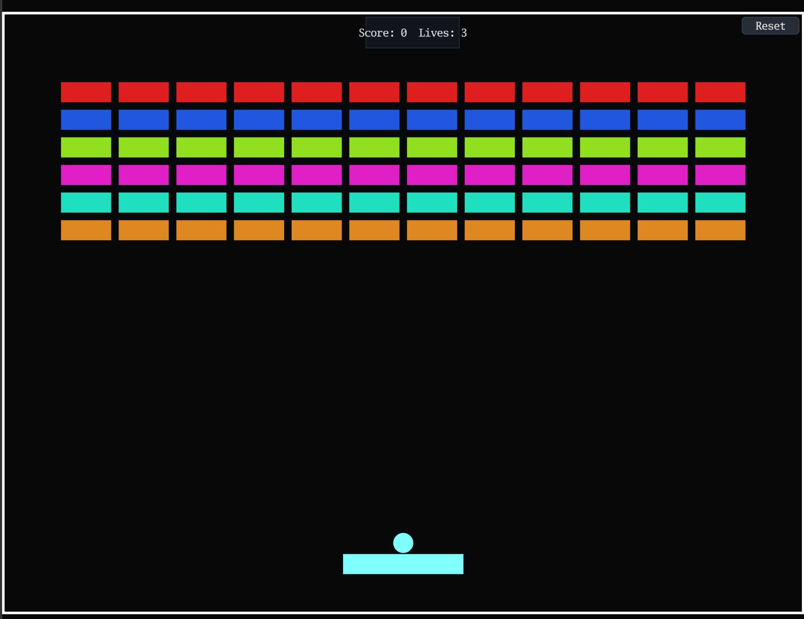

# Breakout

Break every brick with the ball and keep it in play with the paddle.

[](https://dhannyell.github.io/arasy/examples/breakout/)



## What it shows

- A physics world with contacts between the ball, the paddle, the bricks, and the walls.
- An immediate-mode UI overlay for the menu, the score, and the reset button.
- The dev panel, which can pause, step, and scrub the simulation.
- A golden replay test of real play.

## Controls

- A/D or the left and right arrows: move the paddle.
- Mouse: the paddle follows the pointer.
- Space: launch the ball.

## Run locally

From the repository root:

```bash
go run ./cmd/arasy dev ./examples/breakout/wasm
```

Then open the address that the command prints.

Native window:

```bash
go run ./cmd/arasy run ./examples/breakout/native
```
