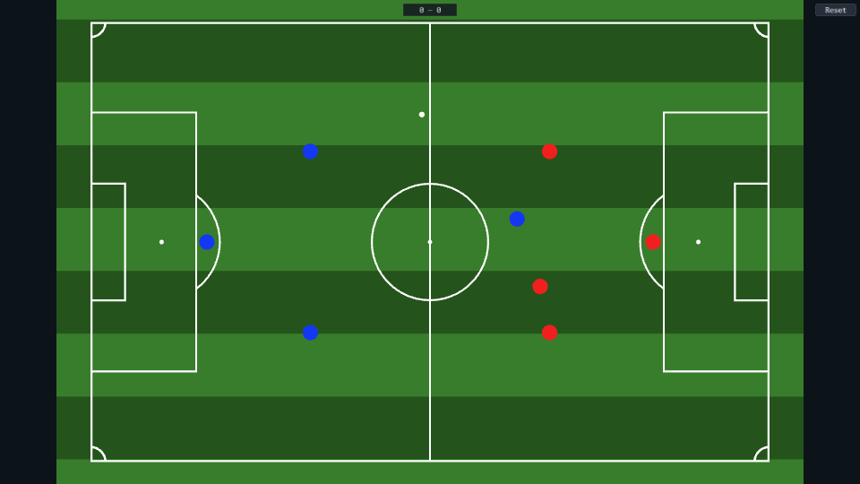

# Football

A small football match between two teams.

[](https://dhannyell.github.io/arasy/examples/football/)



## What it shows

- Team movement and collisions between the players and the ball in the physics world.
- One controlled player driven by semantic input actions.
- A UI overlay for the menu, the score, and the reset button.

## Controls

- WASD or the arrow keys: move your player.
- Run into the ball to push it toward the goal.

## Run locally

From the repository root:

```bash
go run ./cmd/arasy dev ./examples/football/wasm
```

Then open the address that the command prints.

Native window:

```bash
go run ./cmd/arasy run ./examples/football/native
```

Offline PNG through the raster host:

```bash
go run ./examples/football/raster
```
