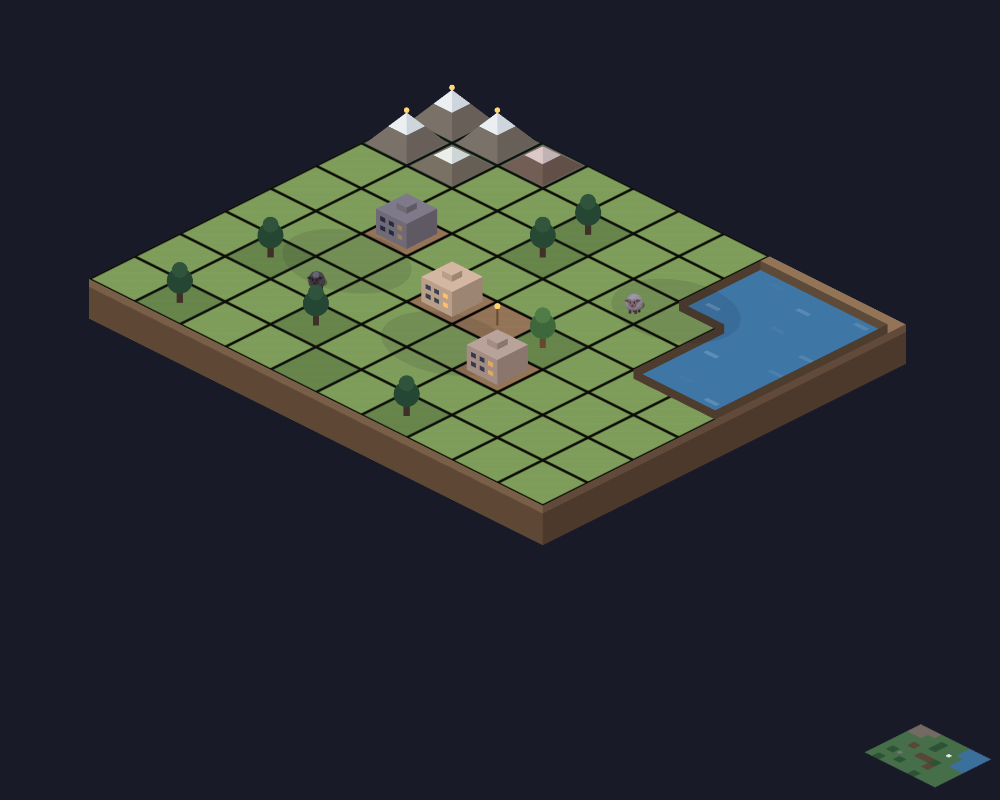

# Outpost

An isometric floating island drawn only with vector commands.

[](https://dhannyell.github.io/arasy/examples/outpost/)



## What it shows

- `Camera.View` as the whole projection: the world is a square grid, and one affine turns it into diamonds on screen.
- Volume through extrusion, height through `scene.Height`, and shadows from the ground projection.
- Depth order through one layer and base sorting, with composites built from `scene.Attachment`.
- Picking through `ScreenToWorld`, and render-only light from an ambient light and a point light.

## Controls

- Click a unit: select it.
- Click a grass tile: send the selected unit there.
- Arrow keys and Enter: move the selection and confirm.

## Run locally

From the repository root:

```bash
go run ./cmd/arasy dev ./examples/outpost/wasm
```

Then open the address that the command prints.

Native window:

```bash
go run ./cmd/arasy run ./examples/outpost/native
```

Offline PNG through the raster host:

```bash
go run ./examples/outpost/raster
```
