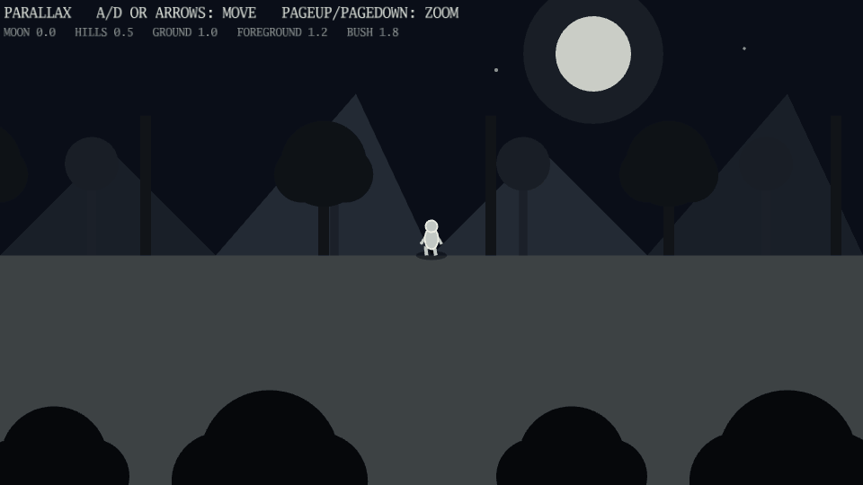

# Parallax

A side-scroller made from declarative camera layers.

[](https://dhannyell.github.io/arasy/examples/parallax/)



## What it shows

- Camera layers with a parallax factor each, from the distant sky to the foreground.
- A repeated backdrop and an infinite flat floor.
- Zoom that applies to every layer through the same camera.

## Controls

- A/D or the left and right arrows: move.
- Page Up and Page Down: zoom.

## Run locally

From the repository root:

```bash
go run ./cmd/arasy dev ./examples/parallax/wasm
```

Then open the address that the command prints.

Native window:

```bash
go run ./cmd/arasy run ./examples/parallax/native
```

Offline PNG through the raster host:

```bash
go run ./examples/parallax/raster
```
