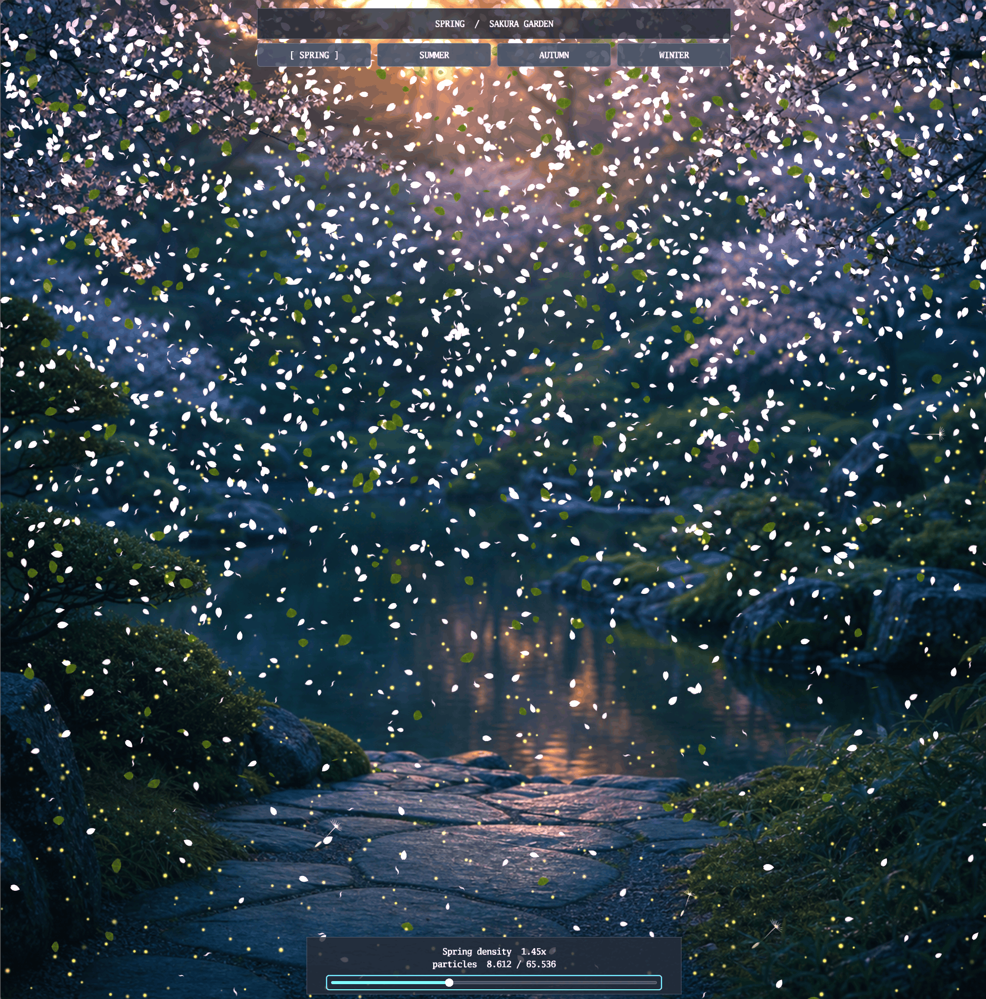

# Particle example

[](https://dhannyell.github.io/arasy/examples/particles/)



This example showcases Arasy's particle system in four seasonal scenes:

- spring: petals, leaves, pollen, butterflies, and dandelion seeds;
- summer: fire, smoke, embers, fireflies, ash, and heat haze;
- autumn: leaves, samaras, fog, and drizzle;
- winter: snow, crystals, condensation, and frost.

Each scene uses its own background, particle layers declared in
`assets/manifest.json`, and a density control that can reach 65,536 particles.
The example runs on the WASM host, using WebGPU when available and Canvas2D as
a fallback.

## Run

From the repository root:

```bash
go run ./cmd/arasy dev ./examples/particles/wasm
```

Then open the address that the command prints. The buttons at the top switch between
seasons, and the control at the bottom changes particle density. The WASM
platform development panel can be opened with the backtick key.

## Structure

- `game.go`: scene, layer, and example UI configuration;
- `wasm/main.go`: WASM host entry point;
- `assets/manifest.json`: textures and effects used by the scenes;
- `CREDITS.md`: visual asset origins and licenses.

## Verification

```powershell
go test ./examples/particles
```

The WASM build above verifies compatibility of the example's entry point.
