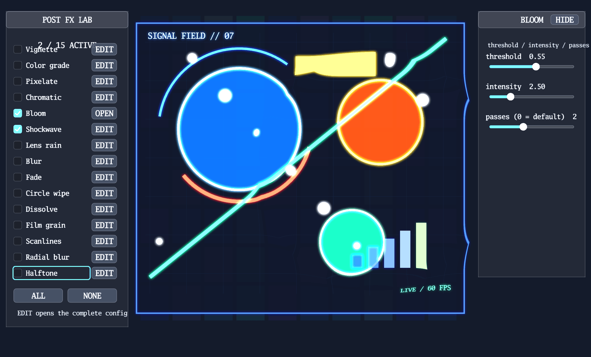

# Post-processing example

[](https://dhannyell.github.io/arasy/examples/postfx/)



This example is a single visual test bench for the post effects exposed by
`render.PostChain`: Vignette, ColorGrade, Pixelate, ChromaticAberration,
Bloom, Shockwave, LensRain, Blur, RadialBlur, Scanlines, FilmGrain, Fade,
Dissolve, CircleWipe, and Halftone.

The left panel toggles effects independently and selects the effect to inspect.
The compact panel on the right exposes every field accepted by that effect,
including RGBA channels, Shockwave's center/radius/width/strength, and
LensRain's editable seed. `HIDE` removes the parameter panel while `SHOW
PARAMS` restores it. Bloom is the only effect enabled on startup. The scene is
procedural, so it has no external assets and keeps bright shapes, fine detail,
and moving edges visible for every effect. The post chain stops at
`ui.LayerBase`; the game UI and the development panel remain unprocessed.

## Run

Native development build:

```bash
go run -tags arr_dev ./examples/postfx/native
```

Offline raster render:

```bash
go run ./examples/postfx/raster
```

Browser development build:

```bash
go run ./cmd/arasy dev ./examples/postfx/wasm
```

The browser host uses WebGPU when available and can fall back to Canvas2D;
Canvas2D intentionally skips effects without an equivalent fullscreen sampling
primitive.
