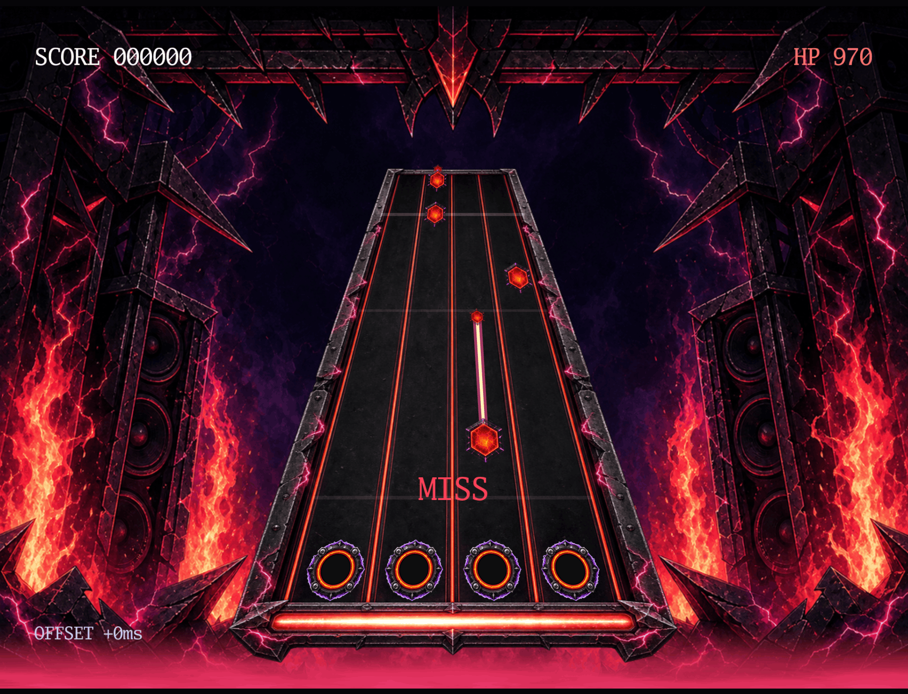

# Rhythm

A four-lane rhythm game: hit each note when it reaches the line.

[](https://dhannyell.github.io/arasy/examples/rhythm/)



## What it shows

- Input judgment synced to the audio, with the result stored in the deterministic simulation.
- A calibration offset that is part of the game state, so a replay judges each hit the same way.
- Audio cues and tracks through the `audio` package.

## Controls

- Space: start.
- A, S, J, K: hit the four lanes.
- Left and right arrows: change the calibration offset by 5 ms.

## Run locally

From the repository root:

```bash
go run ./cmd/arasy dev ./examples/rhythm/wasm
```

Then open the address that the command prints.

Native window:

```bash
go run ./cmd/arasy run ./examples/rhythm/native
```

Offline PNG through the raster host:

```bash
go run ./examples/rhythm/raster
```
