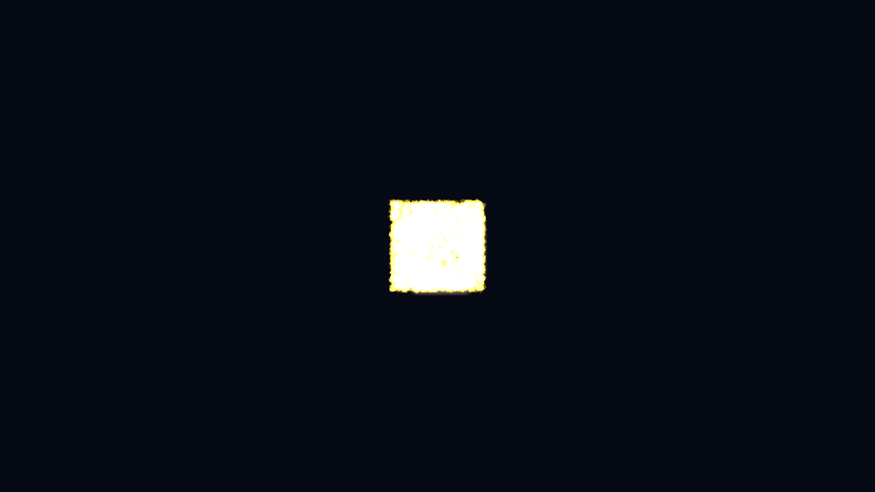

# Splash screen

The boot splash playlist that plays before the first tick.

[](https://dhannyell.github.io/arasy/examples/splashscreen/)



## What it shows

- The default engine segment plays first.
- A developer segment from the `splash` section of the manifest follows: a flip-book texture packed with `arasy atlas`.
- Neither segment touches the game Update or Render.

## Controls

- Reload the page to see the playlist again.

## Run locally

From the repository root:

```bash
go run ./cmd/arasy dev ./examples/splashscreen/wasm
```

Then open the address that the command prints.

Native window:

```bash
go run ./cmd/arasy run ./examples/splashscreen/native
```

Offline PNG through the raster host:

```bash
go run ./examples/splashscreen/raster
```
