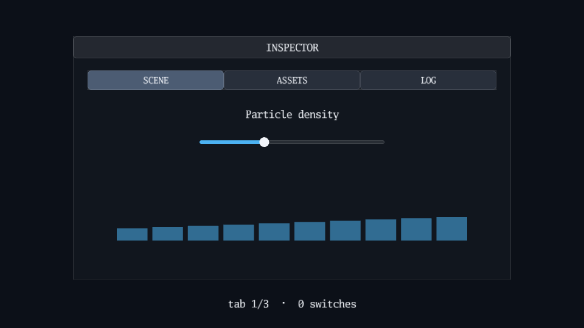

# Tabs

The tab widget and the titled panel of the `ui` package.

[](https://dhannyell.github.io/arasy/examples/tabs/)



## What it shows

- One container with tabs, each with a different kind of content.
- Selection in Update, drawing in Render, and caller layout inside the body rectangle that the widget returns.

## Controls

- Click a tab: show its content.

## Run locally

From the repository root:

```bash
go run ./cmd/arasy dev ./examples/tabs/wasm
```

Then open the address that the command prints.

Native window:

```bash
go run ./cmd/arasy run ./examples/tabs/native
```

Offline PNG through the raster host:

```bash
go run ./examples/tabs/raster
```
