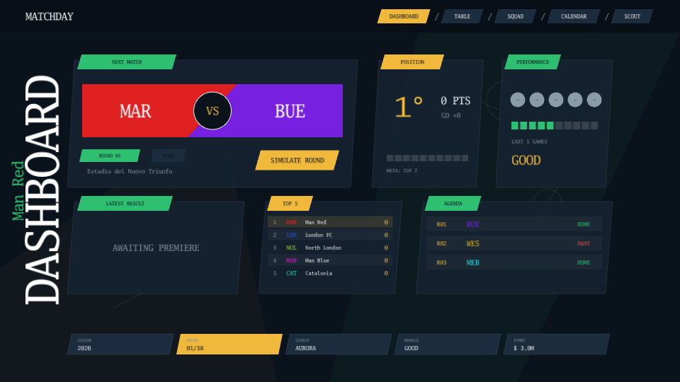

# Matchday

A football manager with dense data screens.

[](https://dhannyell.github.io/arasy/examples/uimanager/)



## What it shows

- Data screens driven by deterministic, headless data, with no scene simulation and no physics.
- Navigation, selection, and focus in the `ui` package.
- Rewind of the UI state together with the game state.

## Controls

- Mouse: use the buttons and the tabs.
- Tab: move the focus.
- Left and right arrows: move between screens.
- Enter: confirm. Escape: go back.

## Run locally

From the repository root:

```bash
go run ./cmd/arasy dev ./examples/uimanager/wasm
```

Then open the address that the command prints.

Native window:

```bash
go run ./cmd/arasy run ./examples/uimanager/native
```
