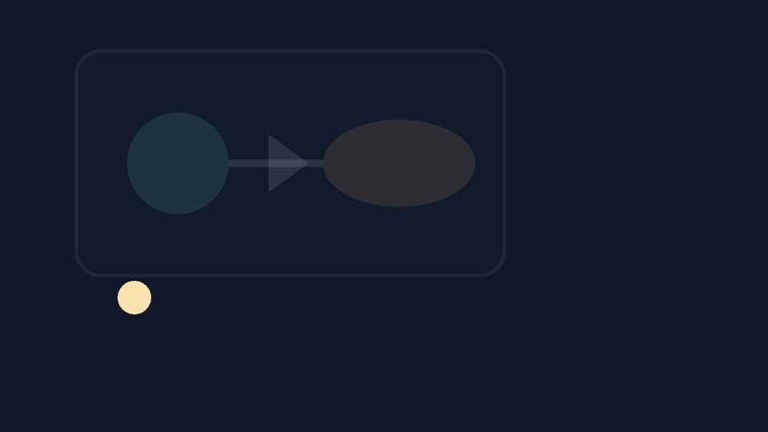

# Vector animation

Generated and hand-authored vector animation.

[](https://dhannyell.github.io/arasy/examples/vectoranim/)



## What it shows

- Timelines from the `anim` package that drive shape, color, and path properties.
- Generated animation next to hand-authored animation in one scene.

## Run locally

From the repository root:

```bash
go run ./cmd/arasy dev ./examples/vectoranim/wasm
```

Then open the address that the command prints.

Native window:

```bash
go run ./cmd/arasy run ./examples/vectoranim/native
```

Offline PNG through the raster host:

```bash
go run ./examples/vectoranim/raster
```
